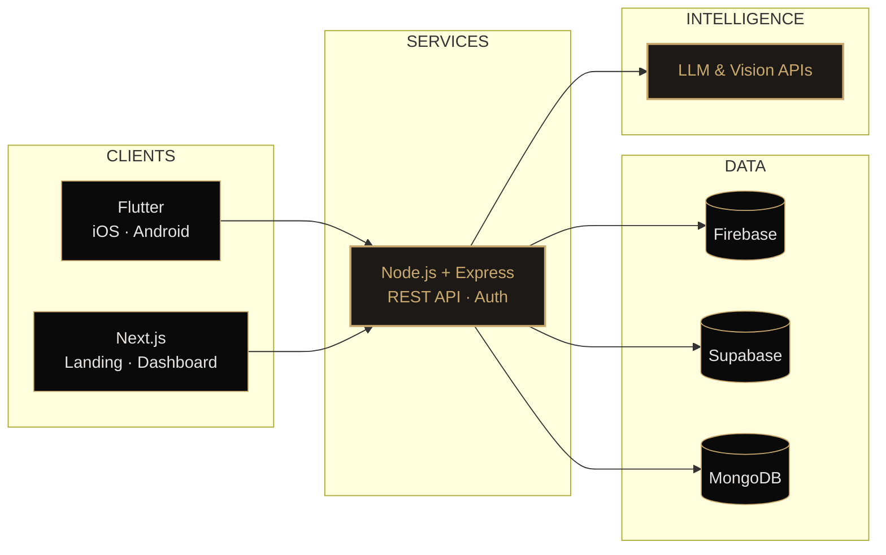

  

 

 

 

### I design and ship complete digital products.
**A mobile app people open daily. A web presence that converts. A backend and intelligence layer that make both work.**

 

 

### 01 &nbsp;/&nbsp; SURFACES

<table>
<tr>
<td width="33%" valign="top">

`MOBILE`

#### Flutter Apps
Cross-platform iOS and Android products with custom interfaces, fluid motion and store-ready releases.

`Flutter` &nbsp;`Dart`

</td>
<td width="33%" valign="top">

`WEB`

#### Landing Pages & Dashboards
Fast, responsive marketing sites and admin dashboards built with Next.js, delivered with AI-assisted workflows.

`Next.js` &nbsp;`React`

</td>
<td width="33%" valign="top">

`SYSTEMS`

#### APIs & Data
Secure Node.js and Express.js services with authentication, real-time data and subscription billing.

`Node.js` &nbsp;`Express`

</td>
</tr>
<tr>
<td colspan="3" valign="top">

`INTELLIGENCE`

#### Applied AI inside the product
My specialty. I integrate LLM and vision capabilities into mobile and web experiences: server-side prompt pipelines, streaming responses, structured outputs, and cost-aware usage control, so AI feels like a feature of the product and never a gimmick.

</td>
</tr>
</table>

 

### 02 &nbsp;/&nbsp; ARCHITECTURE

 

### 03 &nbsp;/&nbsp; STACK

| | |
|:--|:--|
| **Mobile** |    |
| **Web** |     |
| **Backend** |    |
| **Data** |     |
| **AI** |    |
| **Tooling** |      |

 

### 04 &nbsp;/&nbsp; CASE FILES

> Replace the placeholders with your strongest work: title, one-line outcome, stack, link.

<table>
<tr>
<td width="33%" valign="top">

`CASE 01 · MOBILE`

**Project Name** 
One-line outcome: what it does and for whom.

`Flutter` `Node.js` `AI` 
[Explore →](https://github.com/pawanbhandarry)

</td>
<td width="33%" valign="top">

`CASE 02 · WEB DASHBOARD`

**Project Name** 
One-line outcome: what it does and for whom.

`Next.js` `Supabase` 
[Explore →](https://github.com/pawanbhandarry)

</td>
<td width="33%" valign="top">

`CASE 03 · AI PRODUCT`

**Project Name** 
One-line outcome: what it does and for whom.

`Flutter` `Express` `LLM` 
[Explore →](https://github.com/pawanbhandarry)

</td>
</tr>
</table>

 

### 05 &nbsp;/&nbsp; WORKING PRINCIPLES

<table>
<tr>
<td width="25%" valign="top">`I` <b>Architecture first</b> Structure that keeps features fast to ship and bugs rare.</td>
<td width="25%" valign="top">`II` <b>Design with intent</b> Every screen considered, every interaction earned.</td>
<td width="25%" valign="top">`III` <b>AI-accelerated</b> Modern AI tooling for speed, human judgment for quality.</td>
<td width="25%" valign="top">`IV` <b>Ship and iterate</b> Release early, measure, refine.</td>
</tr>
</table>

 

### 06 &nbsp;/&nbsp; ACTIVITY

 

 

### Have a product to launch?
I take on a limited number of projects and collaborations each quarter.

  

