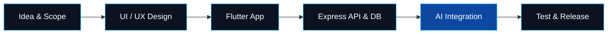

<!-- ===================== HEADER ===================== -->
<div align="center">


<br/>


</div>

<br/>

## ◆ About

I design and ship **cross-platform mobile apps** end to end: polished Flutter interfaces, a robust Express.js backend, and AI features that feel native to the product rather than bolted on.

With **3+ years of experience** and **20+ apps delivered**, I focus on clean architecture, performance, and products people actually enjoy using. My specialty is **integrating AI into mobile apps**: vision, chat, generation, and smart automation, from prompt design to production APIs.

```text
const pawan = {
  role:       "Full-Stack Mobile App Developer",
  mobile:     ["Flutter", "Dart"],
  backend:    ["Node.js", "Express.js", "REST APIs"],
  specialty:  "Integrating AI into mobile apps",
  approach:   ["Clean architecture", "Scalable systems", "Pixel-level UI"],
  currently:  "Building AI-first apps & shipping indie products",
  openTo:     ["Freelance projects", "Collaborations", "Product ideas"],
};
```

<br/>

## ◆ What I Build

<table>
<tr>
<td width="50%" valign="top">

### 📱 Mobile Apps
Production Flutter apps for **iOS & Android**, from concept and UI design to Play Store / App Store release. Smooth animations, solid state management, offline-ready.

</td>
<td width="50%" valign="top">

### 🤖 AI-Powered Features
LLM chat, image recognition, content generation, and smart workflows wired directly into app experiences, with secure server-side API handling.

</td>
</tr>
<tr>
<td width="50%" valign="top">

### ⚙️ Backend & APIs
Scalable **Express.js** services, authentication, real-time data, payments, and cloud deployment, built to grow with your user base.

</td>
<td width="50%" valign="top">

### 🏗️ Architecture
Maintainable codebases with clear separation of concerns, so features ship faster and bugs stay rare.

</td>
</tr>
</table>

<br/>

## ◆ Tech Stack

<div align="center">

**Mobile**<br/>
<br/><br/>

**Backend**<br/>
<br/><br/>

**Databases & BaaS**<br/>
<br/><br/>

**Cloud & DevOps**<br/>
<br/><br/>

**Design & Tooling**<br/>
<br/><br/>

**AI**<br/>


</div>

<br/>

## ◆ Featured Projects

> Replace the placeholders below with your best 3 to 4 projects (name, one-line pitch, stack, link).

<table>
<tr>
<td width="33%" valign="top">

### 🔹 Project One
One-line pitch about what it does and who it is for.

`Flutter` `Express.js` `AI`

[View project →](https://github.com/pawanbhandarry)

</td>
<td width="33%" valign="top">

### 🔹 Project Two
One-line pitch about what it does and who it is for.

`Flutter` `Firebase`

[View project →](https://github.com/pawanbhandarry)

</td>
<td width="33%" valign="top">

### 🔹 Project Three
One-line pitch about what it does and who it is for.

`Flutter` `Supabase` `AI`

[View project →](https://github.com/pawanbhandarry)

</td>
</tr>
</table>

<br/>

## ◆ How I Work



<br/>

## ◆ GitHub Activity

<div align="center">


</div>

<br/>

## ◆ Let's Build Something

Have an app idea, an AI feature you want to ship, or a product that needs a reliable developer? I'm always open to meaningful projects and collaborations.

<div align="center">

<a href="mailto:bhandarrypawan@gmail.com"></a>
<a href="https://linkedin.com/in/pawan-b-rijal-b33654229"></a>
<a href="https://instagram.com/bhandarrypawan77"></a>

<br/><br/>

<sub>Thanks for stopping by. Explore the repositories and reach out anytime.</sub>


</div>
