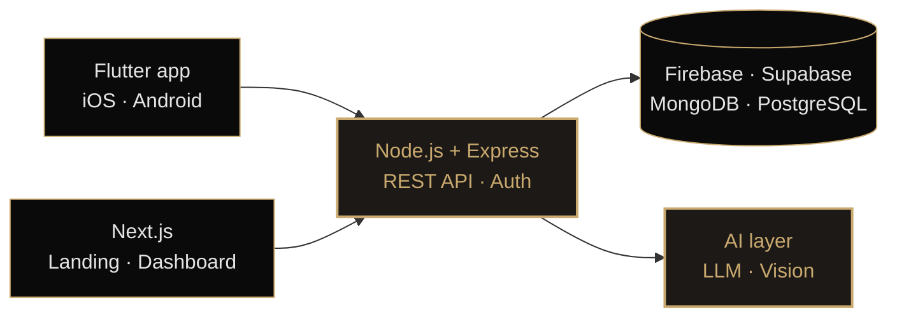

# Pawan Bhandari

**Mobile, Web & Applied AI Engineer** &nbsp;·&nbsp; Flutter &nbsp;·&nbsp; Next.js &nbsp;·&nbsp; Node.js

I build complete digital products: the mobile app, the web presence and dashboard, the API behind them, and the AI that makes them smarter. **3+ years. 20+ products shipped.**

```console
pawan@studio ~ $ whoami
Pawan Bhandari, Full-Stack Mobile Engineer

pawan@studio ~ $ cat focus.txt
→ Flutter apps for iOS and Android
→ Next.js landing pages and web dashboards
→ Node.js / Express APIs and data layers
→ AI integration inside real products

pawan@studio ~ $ status
● Open to select freelance projects and collaborations
```

<br/>

## What I deliver

| Service | What you get | Built with |
|:--|:--|:--|
| **Mobile Apps** | Production-ready iOS and Android products, from interface design to store release | Flutter · Dart |
| **Landing Pages** | Fast, responsive, SEO-ready marketing sites that convert | Next.js · React |
| **Web Dashboards** | Admin panels and analytics with authentication and live data | Next.js · Node.js · Supabase / Firebase |
| **Backend & APIs** | Secure REST APIs, authentication, subscriptions and real-time data | Node.js · Express.js |
| **AI Integration** | LLM and vision features: prompt pipelines, streaming responses, structured outputs, cost control | OpenAI · Gemini · Claude |

<br/>

## System design

How a typical product I ship fits together:



<br/>

## Stack

```yaml
engineer: pawan_bhandari
experience: 3+ years

mobile:    [Flutter, Dart, Kotlin]
web:       [Next.js, React, TypeScript, Tailwind CSS]
backend:   [Node.js, Express.js, REST APIs]
data:      [Firebase, Supabase, MongoDB, PostgreSQL]
ai:        [OpenAI, Gemini, Claude]
tooling:   [Git, Docker, Cloudflare, Figma, Postman]
```

<br/>

## Selected work

| Project | Type | Stack | |
|:--|:--|:--|:--|
| **Project name**<br/><sub>One-line outcome: what it does and for whom.</sub> | Mobile app | Flutter · Node.js · AI | [View →](https://github.com/pawanbhandarry) |
| **Project name**<br/><sub>One-line outcome: what it does and for whom.</sub> | Web dashboard | Next.js · Supabase | [View →](https://github.com/pawanbhandarry) |
| **Project name**<br/><sub>One-line outcome: what it does and for whom.</sub> | AI product | Flutter · Express · LLM | [View →](https://github.com/pawanbhandarry) |

<br/>

## How I work

- **Architecture first.** A clear structure keeps features fast to ship and bugs rare.
- **Design with intent.** Every screen is considered and every interaction earns its place.
- **AI-accelerated, human-reviewed.** Modern AI tooling for speed on interface-heavy work, with engineering judgment on architecture, security and quality.
- **Ship, measure, iterate.**

<br/>

## GitHub

<p>
  
  
</p>

<br/>

## Let's talk

Have a product to launch or an AI feature to ship? I take on a limited number of projects each quarter.

<a href="mailto:bhandarrypawan@gmail.com"></a>
<a href="https://linkedin.com/in/pawan-b-rijal-b33654229"></a>
<a href="https://instagram.com/bhandarrypawan77"></a>
