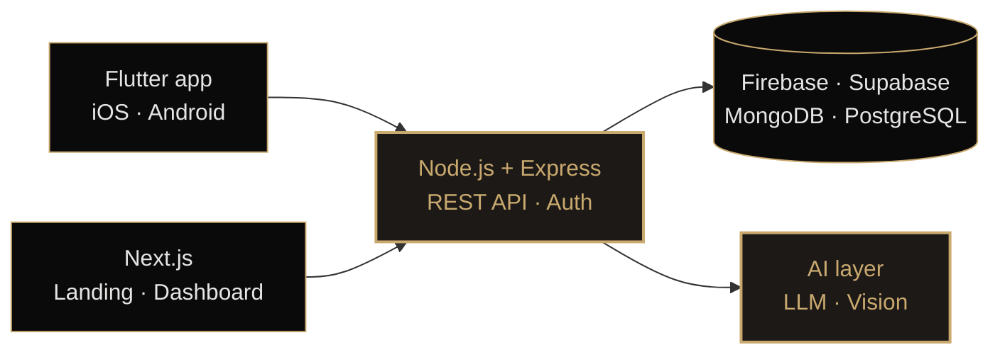

<table>
<tr>
<td width="150" valign="middle" align="center">
  
</td>
<td valign="middle">

# Pawan Bhandari
**Mobile, Web & Applied AI Engineer** 
Flutter · Next.js · Node.js · AI Integration

</td>
</tr>
</table>

<table>
<tr>
<td align="center" width="20%">EXPERIENCE <h3>3+</h3>Years</td>
<td align="center" width="20%">DELIVERED <h3>20+</h3>Apps</td>
<td align="center" width="20%">MOBILE <h3>Flutter</h3>iOS · Android</td>
<td align="center" width="20%">WEB <h3>Next.js</h3>Sites · Dashboards</td>
<td align="center" width="20%">SPECIALTY <h3>AI</h3>In-app intelligence</td>
</tr>
</table>

## What's Inside

I build complete digital products: a polished **Flutter** app, a fast **Next.js** landing page and web dashboard, a dependable **Node.js / Express** backend, and **AI features** woven into the experience instead of bolted on.

Alongside client work, I design and ship my own app products as an independent developer.

## Preview

<!-- Replace each placeholder with a real app screenshot (recommended width: 180 to 200). -->
<table>
<tr>
<td align="center"></td>
<td align="center"></td>
<td align="center"></td>
<td align="center"></td>
</tr>
</table>

## Information

| | |
|:--|:--|
| **Developer** | Pawan Bhandari |
| **Category** | Mobile · Web · Applied AI |
| **Platforms** | iOS · Android · Web |
| **Languages** | Dart · TypeScript / JavaScript · Kotlin |
| **Frameworks** | Flutter · Next.js · React · Express.js |
| **Backend & Data** | Node.js · Firebase · Supabase · MongoDB · PostgreSQL |
| **AI** | OpenAI · Gemini · Claude |
| **Tooling** | Git · Docker · Cloudflare · Figma · Postman |
| **Engagement** | Freelance projects · Collaborations |
| **Availability** | Open to select projects |

<b>Under the hood</b>: how a typical product fits together

 

## More by this Developer

<table>
<tr>
<td width="33%" valign="top">

**Project Name** 
Mobile app · Flutter · Node.js  
One-line outcome: what it does and for whom.  
[**OPEN →**](https://github.com/pawanbhandarry)

</td>
<td width="33%" valign="top">

**Project Name** 
Web dashboard · Next.js · Supabase  
One-line outcome: what it does and for whom.  
[**OPEN →**](https://github.com/pawanbhandarry)

</td>
<td width="33%" valign="top">

**Project Name** 
AI product · Flutter · Express  
One-line outcome: what it does and for whom.  
[**OPEN →**](https://github.com/pawanbhandarry)

</td>
</tr>
</table>

<!--
## Ratings & Reviews
Add a real client review here once you have one, for example from Fiverr:
> ★★★★★ "Short, specific quote about the result you delivered." — Client name
-->

 

**Have a product to launch or an AI feature to ship?** 
I take on a limited number of projects each quarter.

  

